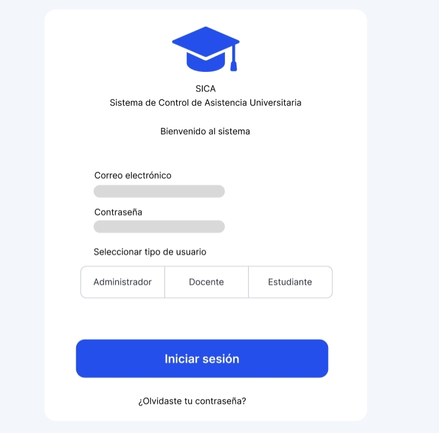
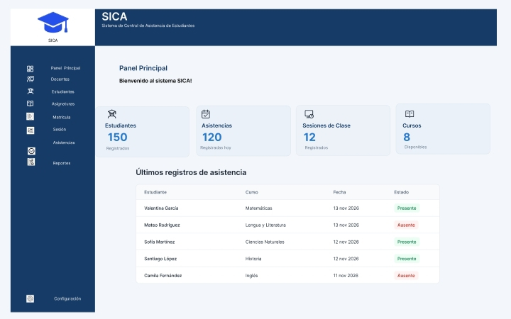

# Sistema de Control de Asistencia de Estudiantes

**Proyecto Integrador I · UNAN-León**

> Prototipo académico para el diseño de una base de datos relacional y
> la simulación de operaciones de control de asistencia estudiantil.

------------------------------------------------------------------------

## 📌 Descripción del proyecto

El proyecto consiste en el diseño y desarrollo de un prototipo académico
de un sistema digital de control de asistencia de estudiantes, basado en
una base de datos relacional.

Su propósito es representar cómo se puede organizar, almacenar y
consultar la información académica para sustituir el registro
tradicional de asistencia en papel, reducir errores y facilitar el
seguimiento de las faltas por estudiante, curso y fecha.

La base de datos contempla siete entidades principales: `ESTUDIANTE`,
`DOCENTE`, `CURSO`, `MATRICULA`, `SESION_CLASE`, `ASISTENCIA` y
`USUARIO`. Su diseño incorpora claves primarias, claves foráneas y
restricciones de integridad.

El proyecto se organiza mediante una arquitectura lógica de tres capas:
presentación, lógica de negocio y datos.

## 🎯 Objetivo

Diseñar y documentar un prototipo de un sistema de control de asistencia
que permita representar el registro, la organización y la consulta de
las asistencias de los estudiantes de manera ordenada y eficiente.

## 🗂️ Entidades principales

  -----------------------------------------------------------------------
  Entidad                             Descripción
  ----------------------------------- -----------------------------------
  `ESTUDIANTE`                        Almacena la información básica de
                                      los estudiantes.

  `DOCENTE`                           Registra los docentes responsables
                                      de impartir los cursos.

  `CURSO`                             Contiene los cursos y grupos
                                      asociados a docentes.

  `MATRICULA`                         Relaciona a los estudiantes con los
                                      cursos.

  `SESION_CLASE`                      Registra las sesiones realizadas
                                      para cada curso.

  `ASISTENCIA`                        Guarda el estado de asistencia de
                                      cada estudiante en una sesión.

  `USUARIO`                           Almacena los nombres de usuario,
                                      hashes de contraseña y roles.
  -----------------------------------------------------------------------

## ⚙️ Funcionalidades

El diseño del sistema contempla las siguientes operaciones:

-   Gestión de estudiantes, docentes y cursos.
-   Administración de matrículas.
-   Registro de sesiones de clase.
-   Registro de asistencia con los estados **Presente** y **Ausente**.
-   Validación de estudiantes y matrículas.
-   Verificación de que una sesión pertenezca al curso correspondiente.
-   Prevención de registros duplicados de asistencia.
-   Generación de reportes con estudiantes presentes, ausentes y sin
    registro.
-   Control de acceso mediante usuarios autorizados, contemplado en el
    diseño de la base de datos.

### Estado de implementación

La lógica de negocio cuenta con una simulación funcional en Python que
implementa validaciones, registro de asistencia y generación de reportes
utilizando datos en memoria.

Las demás operaciones forman parte del diseño del prototipo y no
representan una aplicación completa implementada.

## 🧰 Tecnologías y herramientas

  -----------------------------------------------------------------------
  Tecnología / herramienta            Uso en el proyecto
  ----------------------------------- -----------------------------------
  **Python**                          Simulación de la lógica de negocio
                                      y ejecución de pruebas funcionales.

  **MariaDB**                         Sistema gestor utilizado para crear
                                      y administrar la base de datos
                                      relacional.

  **SQL**                             Definición de tablas, relaciones y
                                      restricciones de integridad.

  **Figma**                           Herramienta destinada al diseño de
                                      interfaces y del prototipo visual.

  **Draw.io (diagrams.net)**          Elaboración del modelo
                                      entidad-relación.

  **Git**                             Control de versiones del proyecto.

  **GitHub**                          Alojamiento y colaboración sobre el
                                      repositorio.

  **Termux**                          Entorno utilizado desde Android
                                      para trabajar con el repositorio,
                                      Python y MariaDB.
  -----------------------------------------------------------------------

## 🏗️ Arquitectura del sistema

El proyecto contempla una separación lógica en tres capas:

### 1. Presentation · Presentación

Representa la interfaz mediante la cual los usuarios interactuarían con
el sistema. Esta capa contempla el diseño de pantallas, formularios y
consultas.

### 2. Business · Lógica de negocio

Contiene las reglas y operaciones principales del sistema. La simulación
en Python implementa validaciones, registro de asistencia y generación
de reportes.

### 3. Data · Datos

Contiene la estructura de la base de datos relacional, incluyendo
tablas, campos, relaciones y restricciones definidas mediante SQL.

> **Nota sobre la arquitectura:** estas capas representan la
> organización lógica del prototipo. La simulación en Python utiliza
> datos en memoria y no está conectada directamente a MariaDB.

## 📁 Estructura del repositorio

``` text
proyecto-integrador/
├── docs/
│   ├── diccionario_datos/
│   │   └── diccionario_datos.pdf
│   ├── documentacion/
│   │   └── documento_tecnico_bd_control_asistencia.pdf
│   ├── figma/
│   │   └── capturas/
│   └── modelo_entidad_relacion/
│       └── modelo_entidad_relacion.drawio
├── src/
│   ├── business/
│   │   ├── asistencia.py
│   │   ├── reportes.py
│   │   └── validaciones.py
│   ├── data/
│   │   └── database.sql
│   ├── presentation/
│   └── __init__.py
├── tests/
│   ├── prueba_asistencia.py
│   ├── prueba_reportes.py
│   └── prueba_validaciones.py
├── .gitignore
└── README.md
```

## 🧪 Pruebas funcionales

El proyecto cuenta con archivos de prueba para verificar el
comportamiento de la lógica de negocio:

  -----------------------------------------------------------------------
  Archivo                             Qué comprueba
  ----------------------------------- -----------------------------------
  `prueba_validaciones.py`            Existencia de estudiantes,
                                      matrículas y estados de asistencia
                                      válidos.

  `prueba_asistencia.py`              Registro correcto de asistencia y
                                      rechazo de operaciones no válidas o
                                      duplicadas.

  `prueba_reportes.py`                Cálculo de presentes, ausentes,
                                      estudiantes sin registro y
                                      porcentaje de asistencia.
  -----------------------------------------------------------------------

### Ejecutar las pruebas

Desde la raíz del repositorio, ejecutar:

``` bash
PYTHONPATH=. python tests/prueba_validaciones.py
PYTHONPATH=. python tests/prueba_asistencia.py
PYTHONPATH=. python tests/prueba_reportes.py
```

**Estado actual:** las tres pruebas se ejecutaron correctamente en el
entorno de desarrollo.

## 📚 Documentación del proyecto

El repositorio contiene los siguientes documentos de referencia:

-   **Diccionario de datos:** describe las tablas, los campos, los tipos
    de datos y las restricciones.
-   **Modelo entidad-relación:** representa gráficamente las entidades y
    sus relaciones.
-   **Documento técnico de diseño de base de datos:** describe el
    problema, los objetivos, las entidades, las relaciones, la
    normalización y las reglas de integridad.

### Prototipo visual en Figma

Se elaboró un prototipo visual preliminar para representar cómo podría
verse el sistema. Actualmente incluye:

- Pantalla de inicio de sesión con campos de correo electrónico y contraseña.
- Selección del tipo de usuario.
- Panel principal con menú de navegación y estadísticas.
- Apartados visuales para estudiantes, docentes, cursos, matrículas,
  sesiones, asistencias y reportes.

**Enlace al prototipo:** [Ver diseño en Figma](https://www.figma.com/design/ah6tBWNDl3Zp3ofTsXiSnN/Sin-t%C3%ADtulo)

#### Capturas del prototipo

Las siguientes imágenes documentan el avance visual actual:

**Pantalla de inicio de sesión**



**Vista previa de las tablas**



El prototipo se encuentra en desarrollo y representa una propuesta
visual. Sus botones y formularios no están conectados a una aplicación
funcional ni a la base de datos.

## 📍 Alcance y estado del proyecto

El proyecto corresponde a un prototipo académico. Su propósito es
demostrar el diseño de una base de datos relacional y representar
algunas de las operaciones principales mediante una simulación funcional
de la lógica de negocio.

La base de datos se administra de manera independiente mediante MariaDB,
mientras que la simulación en Python trabaja con datos en memoria. **No
existe una conexión directa entre ambas partes.**

El repositorio cuenta con la estructura del proyecto, el diseño SQL, el
modelo entidad-relación, la documentación técnica, el diccionario de
datos y las pruebas funcionales de la lógica implementada.

El prototipo visual inicial ya fue incorporado al repositorio mediante
su enlace y capturas de pantalla. Su diseño todavía puede recibir
modificaciones; por tanto, las imágenes representan el avance actual y
no necesariamente una versión definitiva.

------------------------------------------------------------------------

**Proyecto Integrador I · UNAN-León**
